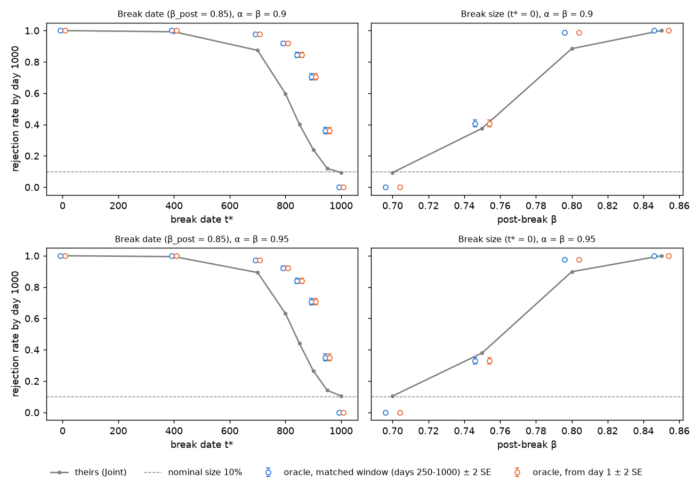

# Extension: e-detectors for systemic risk surveillance

## 1. Time-varying oracle (K = 1)
An upper benchmark: a joint e-Shiryaev–Roberts detector that bets the *true* conditional band probabilities, run on the same Section 3.4 break paths as their Joint detector (common random numbers; K = 1, M = 2000, break_in_X = TRUE).

| item | value |
|---|---|
| null | VaR and CoVaR forecasts correct every day (as theirs) |
| bands | Z_t = 0: no sector VaR miss; 1: sector miss, bank within CoVaR; 2: joint miss; p = (β, (1−β)α, (1−β)(1−α)) |
| oracle bet | q_t(j) = P_true(Z_t = j \| F_{t−1}) from the DGP's true σ_X,t, σ_Y,t, ρ_t and the pre-break forecasts |
| joint SR | M_t = (1 + M_{t−1}) q_t(Z_t)/p(Z_t), M_0 = 0; alarm when M_t ≥ γ = n/ι = 10,000 |
| windows | matched (accumulate from day 1, alarm in days 250..1000, as theirs) and from day 1 |
| theirs | saved Joint run lengths (alarm day = 249 + run length) |

q_t uses a 64-node Gauss–Legendre rule in u = F_ν(x), with 1 − u = sf(a)·w^ν to remove the (1 − u)^{2/ν} endpoint singularity (rel. error ~1e-15). Checks: the recomputed indicators equal the saved ones exactly; q_t = p before the break to 6e-13; post-break band frequencies match mean q_t (|z| < 3); the oracle never alarms before t*.

**Size.** Under the null the oracle bets p, so E_t = 1 and M_t = t < γ: its false-alarm rate is 0 by construction. It is not calibrated.

### Rejection rate by day 1000, α = β = 0.95
"Theirs" includes false alarms before t*, shown in brackets.

| t* | β_post | theirs (pre-break) | oracle, matched | oracle, day 1 | McNemar p |
|---|---|---|---|---|---|
| 0 | 0.85 | 1.000 (0.000) | 1.000 | 1.000 | 1 |
| 400 | 0.85 | 0.995 (0.029) | 1.000 | 1.000 | 0.001 |
| 700 | 0.85 | 0.893 (0.073) | 0.973 | 0.973 | 8e-40 |
| 800 | 0.85 | 0.632 (0.083) | 0.921 | 0.921 | 3e-152 |
| 850 | 0.85 | 0.441 (0.088) | 0.840 | 0.840 | 7e-191 |
| 900 | 0.85 | 0.266 (0.095) | 0.707 | 0.707 | 3e-198 |
| 950 | 0.85 | 0.141 (0.102) | 0.351 | 0.351 | 3e-60 |
| 1000 (no break) | 0.85 | 0.104 (0.104) | 0 | 0 | |
| 0 | 0.70 (no break) | 0.104 | 0 | 0 | |
| 0 | 0.75 | 0.380 | 0.329 | 0.329 | 4e-06 |
| 0 | 0.80 | 0.898 | 0.977 | 0.977 | 5e-36 |

### Delay (alarm day − t*, alarms after t*), α = β = 0.95
Delays are median [IQR]. The paired difference is oracle (matched) − theirs on the paths where both detect, with a bootstrap 95% CI. KL is the median post-break cumulative KL(q‖p) at the alarm (day-1 window). Realised log LR is the median Σ log(q_s/p) over the same days.

| t* | β_post | theirs | oracle, matched | oracle, day 1 | paired diff | KL / log LR | log(γ/(1+t*)) |
|---|---|---|---|---|---|---|---|
| 0 | 0.85 | 250 [250, 258] | 250 [250, 251] | 149 [109, 210] | 0 (0, 0) | 4.51 / 5.39 | 9.21 |
| 400 | 0.85 | 174 [119, 240] | 94 [59, 146] | 94 [59, 146] | −61 (−64, −58) | 2.67 / 3.32 | 3.22 |
| 700 | 0.85 | 160 [113, 209] | 75 [47, 121] | 75 [47, 121] | −69 (−71, −65) | 2.04 / 2.84 | 2.66 |
| 800 | 0.85 | 132 [93, 164] | 69 [44, 106] | 69 [44, 106] | −57 (−61, −54) | 1.83 / 2.71 | 2.52 |
| 850 | 0.85 | 107 [76, 129] | 63 [41, 94] | 63 [41, 94] | −43 (−47, −40) | 1.65 / 2.67 | 2.46 |
| 900 | 0.85 | 73 [54, 89] | 53 [37, 71] | 53 [37, 71] | −27 (−31, −24) | 1.32 / 2.64 | 2.41 |
| 950 | 0.85 | 39 [28, 45] | 34 [26, 42] | 34 [26, 42] | −5 (−10, −2) | 0.73 / 2.60 | 2.35 |
| 0 | 0.75 | 519 [338, 762] | 792 [645, 906] | 792 [645, 906] | +104 (79, 147) | 1.40 / 3.45 | 9.21 |
| 0 | 0.80 | 362 [255, 568] | 367 [273, 513] | 365 [265, 511] | −3 (−5, −1) | 3.54 / 4.38 | 9.21 |

α = β = 0.90 gives the same picture (`data/derived/exp11_grid_M2000_s2026_*.csv`; delays in `figures/exp11_delays.png`).

### Findings
- **Head start.** Before the break the oracle bets p, so M_t = t exactly, and it enters the break at M_{t*} = t*. It then needs only about log(γ/(1+t*)) of post-break evidence, not log γ. The realised post-break log LR at the alarm matches this (e.g. 3.32 vs 3.22 at t* = 400, 2.60 vs 2.35 at t* = 950).
- **The head start makes the advantage partly structural, especially for late breaks.** A realistic detector does not know q_t = p before the break, so it gets no free M_t = t, and the oracle's gains are largest exactly where the head start is largest. At t* = 850–950 the oracle's power is 2–3× theirs (0.84 vs 0.44 at t* = 850). Their rejection rate there is also mostly false alarms before t*: 0.10 of their 0.14 at t* = 950.
- **The bound doesn't hold at t* = 0 either.** There is no head start there, so cumulative KL near log γ would be expected, but it isn't reached. In the matched window the median KL at the alarm is 8.1, because alarms can't come before day 250. From day 1 it is 4.5, with a realised log LR of 5.4. SR sums over all start dates: any stretch where the bet barely pays (q_s ≈ p) adds about 1 per day, just as before a break. The day-1 oracle detects the β_post = 0.85 break about 100 days earlier than theirs, whose alarms can't come before day 250.
- **Small breaks: the uncalibrated threshold costs power.** At β_post = 0.75 the daily KL is about 0.002, about 1.8 nats over the whole sample, far below log γ. The oracle (power 0.33, size 0) loses to their detector (0.38), which is calibrated to an exact 10% size, and it is about 100 days slower on paths both detect. Since M_t = t under the null, any γ > n would still give size 0, so γ = 10n gives up about log 10 of evidence. We did not recalibrate.
- **Delays shrink with t*.** This is censoring at day 1000: only fast detections are counted. At t* = 950 both medians are under 50 days, but the oracle detects 35% of paths against their 4% after the break.

### How to reproduce
| result | command |
|---|---|
| tests (quadrature, detector) | `.venv/bin/pytest -q tests/test_oracle.py tests/test_edetectors.py` |
| one scenario, checks A–F | `experiments/11_oracle_k1.py --scenario t400_b085 --level 0.95` |
| t* ∈ {850, 950} sims | `python -c "from src import power_sims; [power_sims.get(t, 0.85, 2000, 2026) for t in (850, 950)]"` |
| full grid, tables, figures | `experiments/11_oracle_k1.py --grid --jobs 3` (about 10 min) |
