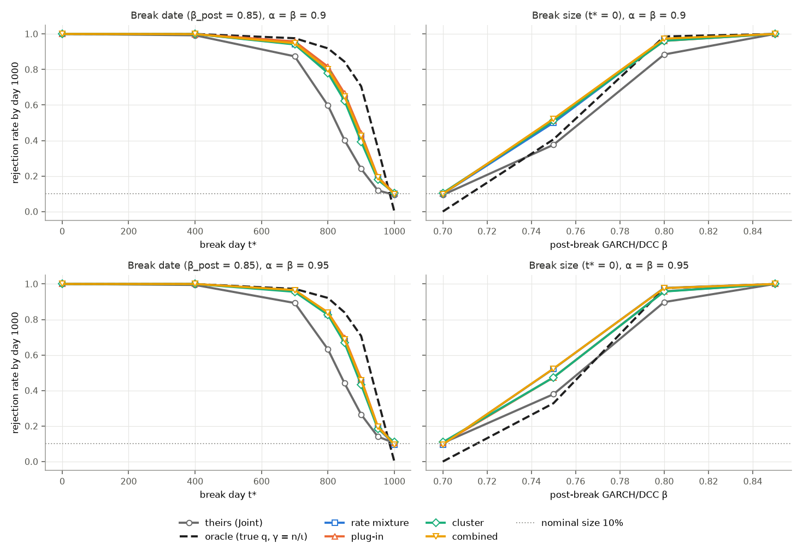
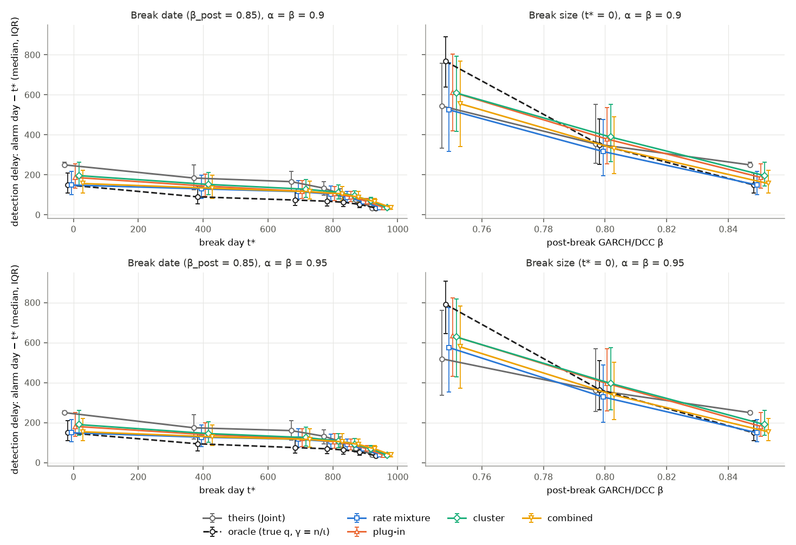
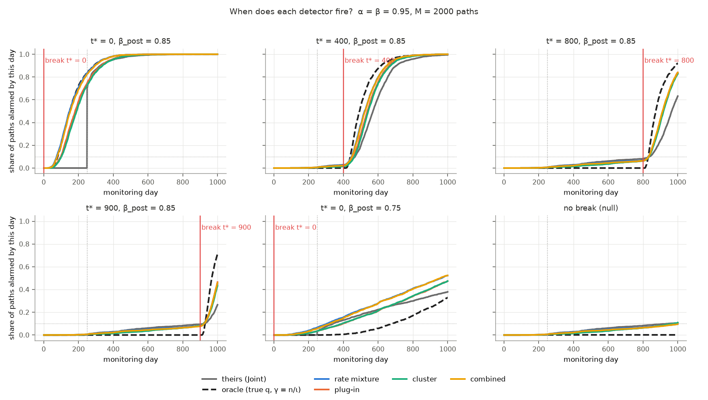
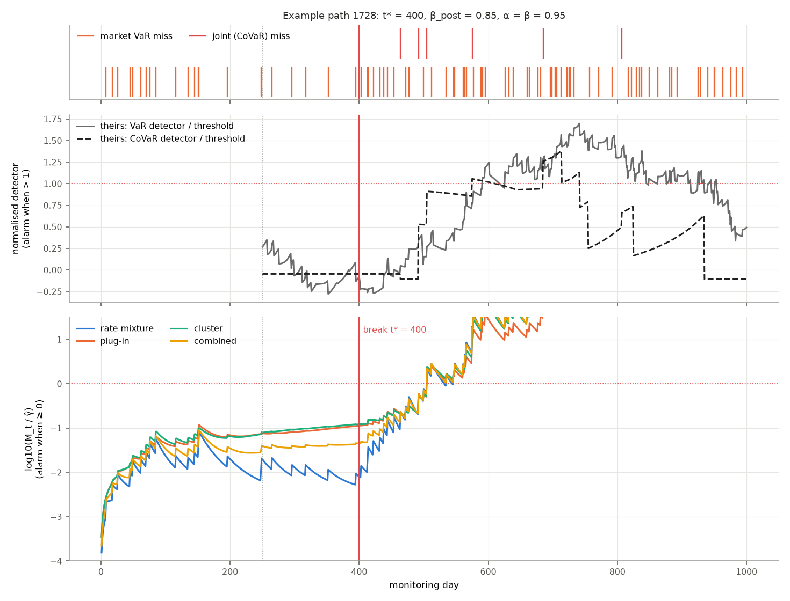

# Extension 2: learned e-detectors vs the paper's Joint detector

Question: can an e-detector that **only sees the violation indicators**, the same information as Dimitriadis &
Hoga's detector, catch **their** break faster or more often than their Joint detector? The detector gets no true
volatility (unlike the Extension 1 oracle) and has a threshold calibrated to the same 10% false-alarm rate.

Setup: K = 1 (market + one bank), α = β ∈ {0.90, 0.95}, n = 1000 monitoring days, ι = 10%, M = 2000 paths per
scenario. Every detector runs on **exactly the same paths** (common random numbers), so all comparisons are paired.
Headline numbers are at α = β = 0.95. α = β = 0.90 gives the same picture (§ 4.7), and all tables are in
`data/derived/exp12_grid_M2000_s2026_summary.csv`.

**Alarm windows.** The headline lets the e-detectors **alarm from day 1**. Their Joint detector **can only alarm from
day 250**, because its statistics need a full 250-day window; that is a limitation of their method, so we don't impose
it on ours. For a like-for-like check, § 4.6 also reports a **matched** version where the e-detectors may only alarm
on days 250–1000 too. The conclusions are the same.

---

## 1. The break being detected (the paper's Section 3.4 break)

- **Data:** each path is a DCC-GARCH-t₅ process, with a market X and a bank Y. GARCH (ω, α_G, β_G) = (0.1, 0.1, 0.7),
  DCC (a, b) = (0.1, 0.7), and correlation 0.5. The first 5001 days are burn-in. **Monitoring covers days 1–1000.**
- **The break happens at monitoring day t*:** from day t* + 1 onward, the GARCH persistence β_G (for X and Y) and the
  DCC persistence b jump from **0.7 to β_post**. The long-run variance ω/(1 − α_G − β_G) rises from 0.5 to 2.0 at
  β_post = 0.85, which doubles the long-run volatility, and volatility becomes more persistent.
- **The forecaster never notices.** VaR and CoVaR forecasts keep using the pre-break parameters, so after t* they
  understate risk. The result is more market VaR misses, more joint misses and more clustering.
- **Two families of scenarios:**
  - *Break date:* t* ∈ {0, 400, 700, 800, 850, 900, 950} with β_post = 0.85. Late breaks leave little time to detect
    before day 1000.
  - *Break size:* β_post ∈ {0.75, 0.80, 0.85} with t* = 0.
  - *Nulls:* t* = 1000 (no break) and β_post = 0.70 (no change). These measure false alarms.
- **Any alarm on or before t\*** is a false alarm, and it is counted in the rejection rate, as in the paper.

---

## 2. The detectors

Every e-detector sees the band Z_t ∈ {0 calm, 1 market miss with the bank within its CoVaR, 2 joint miss}. Under
correct forecasts the band probabilities are p = (β, (1−β)α, (1−β)(1−α)) = (0.95, 0.0475, 0.0025). Each detector bets
q_t, built from Z_1..Z_{t−1} only, and runs the Shiryaev–Roberts recursion
M_t = (1 + M_{t−1})·q_t(Z_t)/p(Z_t). It alarms when M_t ≥ γ.

| detector | bet q_t | paper analogue |
|---|---|---|
| **theirs (Joint)** | none: rolling 250-day UC + Gini, thresholds from Algorithm 1; alarms from day 250 | |
| **oracle** | the *true* band probabilities from the simulation (Extension 1); γ = 10,000 | benchmark (cheats, § 3) |
| **rate mixture** | average of 12 SR processes, each betting on a fixed inflated miss rate (market ×1.5/2/3, joint ×1.5/2/3/5) | UC part |
| **plug-in** | recent band frequencies (EWMA, λ = 0.99) shrunk toward p (κ = 50); never bets fewer misses than p | UC + some clustering |
| **cluster** | separate frequencies for "missed yesterday" vs not (h = 1, λ = 0.99, κ = 50) | Gini part |
| **combined** | ½ rate mixture + ½ cluster | 0.5·UC + 0.5·Gini |

The plug-in and cluster settings were **tuned on separate paths** (seed 7, 500 paths, t* = 400, β_post = 0.85) and
then frozen. All candidates scored within about 7% of each other (`data/derived/exp12_tuning.csv`).

---

## 3. How the threshold is set

The threshold is calibrated the same way the paper calibrates its own (Algorithm 1). For K = 1, Proposition 1 makes
the null law of Z_t **exactly** iid categorical(p), so it can be simulated without any model.

1. Simulate **20,000 null paths** of 1000 days (seed 11, separate from the evaluation paths).
2. Run each detector and record each path's **largest** M_t over the days it may alarm (days 1–1000 for the
   headline; days 250–1000 for the matched version).
3. Set **γ̂ = the 90th percentile** of those maxima, so exactly 10% of null paths ever alarm. The standard error comes
   from a bootstrap over the maxima.

| detector | γ̂, day 1 (headline) | γ̂, matched | false alarms if γ = 10,000 (the guaranteed Ville/Doob bound) |
|---|---|---|---|
| rate mixture | 6,046 ± 119 | 5,543 ± 111 | 5.7% |
| plug-in | 2,831 ± 46 | 2,794 ± 45 | 1.8% |
| cluster | 2,845 ± 43 | 2,808 ± 46 | 1.9% |
| combined | 4,375 ± 87 | 4,143 ± 78 | 3.9% |

- **γ = n/ι = 10,000 is guaranteed but conservative.** M_t is a nonnegative submartingale with E[M_n] = n, so Doob's
  inequality gives P(max M_t ≥ γ) ≤ n/γ. Actual false-alarm rates are only 2–6%, so calibrating lowers the threshold
  by 1.7–3.5× and buys power.
- **Day-1 thresholds are slightly higher than matched ones,** because the same 10% budget has to cover 250 more days.
- **Out-of-sample check passed: 96/96.** On *independent* GARCH null paths (the Table 1 null with M = 5000, and the
  no-break power scenario), the calibrated detectors' false-alarm rates are 9.5–10.9%, all within 3 SE of 10%, in both
  windows.
- **The oracle can't be calibrated this way.** Under the null it bets exactly p, so M_t = t with no randomness: any
  γ > 1000 gives 0% false alarms and any γ ≤ 1000 gives 100%. It keeps Extension 1's γ = 10,000. That threshold is
  stricter than needed, so the oracle is **not a strict upper bound** (see finding 3).

---

## 4. Results (headline: e-detectors alarm from day 1)

### 4.1 Detection rate (share of paths with an alarm by day 1000)

α = β = 0.95. Learned detectors use γ̂.

| t* | β_post | theirs | oracle | rate | plug-in | cluster | combined |
|---|---|---|---|---|---|---|---|
| 0 | 0.85 | 1.000 | 1.000 | 1.000 | 1.000 | 1.000 | 1.000 |
| 400 | 0.85 | 0.994 | 1.000 | 1.000 | 1.000 | 1.000 | 1.000 |
| 700 | 0.85 | 0.893 | 0.972 | 0.964 | 0.963 | 0.956 | 0.966 |
| 800 | 0.85 | 0.632 | 0.922 | 0.829 | 0.840 | 0.826 | 0.839 |
| 850 | 0.85 | 0.441 | 0.840 | 0.678 | 0.697 | 0.668 | 0.690 |
| 900 | 0.85 | 0.266 | 0.707 | 0.447 | 0.465 | 0.432 | 0.458 |
| 950 | 0.85 | 0.141 | 0.351 | 0.189 | 0.198 | 0.186 | 0.196 |
| 0 | 0.80 | 0.898 | 0.976 | 0.978 | 0.958 | 0.958 | 0.977 |
| 0 | 0.75 | 0.380 | 0.328 | **0.522** | 0.474 | 0.474 | **0.524** |
| null: t* = 1000 | | 0.104 | 0 | 0.096 | 0.104 | 0.109 | 0.096 |
| null: β_post = 0.70 | | 0.104 | 0 | 0.096 | 0.104 | 0.109 | 0.096 |

(The two null rows are identical because they are the same no-break paths: same seed, same DGP.)

- **Significance:** wherever the detectors differ, every learned-vs-theirs difference is significant on a paired
  McNemar test (p < 10⁻⁵; p ≈ 10⁻³ at t* = 400, where nearly every path is detected). At t* = 0 with β_post = 0.85,
  every detector catches every path. At the nulls the differences are not significant (p > 0.25).
- **False alarms before the break stay lower than theirs,** even though the e-detectors may now alarm from day 1. At
  t* = 800 the share of paths with a false alarm before the break is 6.2–6.8% for the learned detectors and 8.3% for
  theirs. All of them spend the same 10% budget over the whole period, but the e-detectors spend less of it early.

### 4.2 Detection time after the break

Delay = alarm day − t*, over paths detected after the break: median [IQR], α = β = 0.95.

| t* | β_post | theirs | oracle | rate | plug-in | cluster | combined |
|---|---|---|---|---|---|---|---|
| 0 | 0.85 | 250 [250, 258] | 149 [109, 210] | **149 [105, 215]** | 181 [131, 251] | 190 [138, 261] | 154 [110, 220] |
| 400 | 0.85 | 174 [119, 240] | 94 [59, 146] | 127 [81, 187] | 140 [93, 200] | 145 [101, 204] | 129 [84, 188] |
| 700 | 0.85 | 160 [113, 209] | 75 [47, 121] | 116 [77, 170] | 120 [80, 170] | 125 [83, 177] | 116 [77, 168] |
| 800 | 0.85 | 132 [93, 164] | 69 [44, 106] | 105 [71, 143] | 104 [71, 144] | 108 [74, 146] | 104 [69, 144] |
| 850 | 0.85 | 107 [76, 129] | 63 [41, 94] | 91 [64, 118] | 92 [64, 119] | 92 [64, 121] | 91 [64, 118] |
| 900 | 0.85 | 73 [54, 89] | 53 [37, 71] | 68 [47, 83] | 69 [50, 85] | 70 [50, 86] | 69 [49, 84] |
| 950 | 0.85 | 39 [28, 45] | 34 [26, 42] | 39 [29, 45] | 38 [28, 44] | 37 [28, 44] | 39 [29, 45] |
| 0 | 0.80 | 362 [255, 568] | 365 [265, 511] | 328 [202, 487] | 396 [259, 569] | 396 [265, 576] | 337 [214, 502] |
| 0 | 0.75 | 519 [338, 762] | 792 [645, 906] | 575 [353, 776] | 634 [432, 823] | 628 [428, 817] | 579 [372, 782] |

**Same-path comparison.** Each cell is the median of (detector − theirs) on paths both detect, in days, with a
bootstrap 95% CI. Negative means earlier.

| t* | β_post | rate | plug-in | cluster | combined | oracle |
|---|---|---|---|---|---|---|
| 0 | 0.85 | **−110 (−114, −107)** | −76 (−80, −72) | −70 (−74, −65) | −106 (−110, −102) | −111 |
| 400 | 0.85 | −35 (−38, −32) | −21 (−23, −19) | −16 (−18, −13) | −33 (−36, −30) | −61 |
| 700 | 0.85 | −33 (−36, −30) | −31 (−34, −28) | −26 (−28, −24) | −34 (−37, −31) | −69 |
| 800 | 0.85 | −30 (−33, −28) | −31 (−33, −28) | −24 (−27, −21) | −32 (−34, −29) | −57 |
| 850 | 0.85 | −23 (−26, −22) | −22 (−25, −20) | −19 (−22, −17) | −23 (−25, −20) | −43 |
| 900 | 0.85 | −15 (−18, −13) | −15 (−18, −13) | −12 (−14, −9) | −15 (−18, −13) | −27 |
| 950 | 0.85 | −2 (−6, 0) | −2 (−6, 0) | 0 (−3, 0) | −2 (−6, 0) | −5 |
| 0 | 0.80 | **−67 (−73, −61)** | −21 (−26, −18) | −19 (−24, −14) | −57 (−62, −51) | −26 |
| 0 | 0.75 | −28 (−35, −21) | −10 (−15, −7) | −9 (−14, −3) | −24 (−33, −18) | +104 |

**Why β_post = 0.75 looks slower in the first table but faster in the second.** The learned detectors catch many
*more* paths than theirs (0.52 vs 0.38). The extra paths are the hard, slow ones, and they pull the median up. On the
paths that both detect, the rate mixture is 28 days *earlier*.

### 4.3 When each detector fires

Each curve is the share of the 2000 paths that have alarmed by each day. The **red line is the break day t\***. The
grey dotted line is day 250, the first day **their** detector can alarm.
- **t\* = 0:** the e-detectors start firing around day 50 and have caught about 80% of paths by day 250. Their
  detector can't fire at all until day 250, then jumps. The rate mixture tracks the oracle almost exactly here.
- **Before a later break,** every calibrated detector creeps up slowly; that is the 10% false-alarm budget. The oracle
  sits at 0.
- **After the break,** the learned curves rise sooner and steeper than theirs, and the oracle is steepest.
- **At β_post = 0.75,** the oracle is the slowest because its γ = 10,000 is too strict for a small break.

(At α = β = 0.90: `docs/img/exp12_detection_cdf_a0.9.png`.)

### 4.4 One path, step by step

This is path 1728 at t* = 400 and β_post = 0.85, chosen as the path where theirs has its median detection time.
- **Top panel:** the misses. Market misses and joint misses become much more frequent after day 400.
- **Middle panel:** their two detectors divided by their thresholds. The VaR detector crosses 1 on day 575.
- **Bottom panel:** each e-detector's log10(M_t/γ̂).
  - *Before the break,* the e-detectors climb at first and then level off: M_t ≈ t is the no-evidence baseline.
  - *After the break,* every miss multiplies M_t (the jumps) and calm days shrink it (the decay).
  - *All four cross on day 505,* on a burst of misses that includes a joint miss. That is **70 days before theirs**.

### 4.5 With the guaranteed threshold γ = 10,000 instead of γ̂

| t* | β_post | theirs (size 10.4%) | rate (size 5.6%) | combined (3.8%) | plug-in (1.8%) | cluster (1.8%) |
|---|---|---|---|---|---|---|
| 700 | 0.85 | 0.893 | **0.937** | 0.920 | 0.859 | 0.850 |
| 850 | 0.85 | 0.441 | **0.584** | 0.542 | 0.432 | 0.405 |
| 950 | 0.85 | 0.141 | 0.131 | 0.096 | 0.053 | 0.050 |
| 0 | 0.80 | 0.898 | **0.959** | 0.938 | 0.842 | 0.854 |
| 0 | 0.75 | 0.380 | **0.424** | 0.346 | 0.212 | 0.215 |

Even with the uncalibrated threshold and **half the false-alarm rate**, the rate mixture beats their detector except
at the latest break. That version also needs no simulation and is valid for any monitoring horizon.

### 4.6 Like-for-like check: e-detectors also limited to days 250–1000

Same detectors and paths at α = β = 0.95, but alarms are only allowed from day 250 (γ̂ calibrated for that window).

| t* | β_post | theirs | rate | plug-in | cluster | combined | rate, same-path delay vs theirs |
|---|---|---|---|---|---|---|---|
| 400 | 0.85 | 0.995 | 1.000 | 1.000 | 1.000 | 1.000 | −37 days |
| 800 | 0.85 | 0.632 | 0.843 | 0.842 | 0.827 | 0.845 | −32 days |
| 850 | 0.85 | 0.441 | 0.691 | 0.699 | 0.671 | 0.696 | −25 days |
| 900 | 0.85 | 0.266 | 0.462 | 0.467 | 0.432 | 0.469 | −16 days |
| 0 | 0.80 | 0.898 | 0.979 | 0.958 | 0.958 | 0.979 | −12 days |
| 0 | 0.75 | 0.380 | 0.531 | 0.474 | 0.478 | 0.526 | −17 days |

The e-detectors still win clearly without the early start. Relative to the day-1 headline:
- **Early breaks:** detection is about 100 days slower at t* = 0 and about 55 days slower at β_post = 0.80 on the
  same paths, because of the wait until day 250.
- **Late breaks:** power is ~1pp *higher*, because the 10% budget covers fewer days.

Figures: `docs/img/exp12_power_matched.png`, `exp12_delays_matched.png`, `exp12_detection_cdf_a0.95_matched.png`,
`exp12_example_path_matched.png`.

### 4.7 α = β = 0.90

The same pattern holds; detection rates by day 1000:

| t* | β_post | theirs | oracle | rate | plug-in | cluster | combined |
|---|---|---|---|---|---|---|---|
| 700 | 0.85 | 0.874 | 0.976 | 0.944 | 0.958 | 0.941 | 0.948 |
| 800 | 0.85 | 0.598 | 0.919 | 0.788 | 0.816 | 0.780 | 0.800 |
| 850 | 0.85 | 0.402 | 0.844 | 0.638 | 0.666 | 0.624 | 0.648 |
| 900 | 0.85 | 0.240 | 0.706 | 0.424 | 0.440 | 0.394 | 0.425 |
| 0 | 0.80 | 0.884 | 0.986 | 0.967 | 0.961 | 0.962 | 0.974 |
| 0 | 0.75 | 0.376 | 0.406 | 0.500 | 0.514 | 0.511 | 0.522 |
| null | | 0.094 | 0 | 0.100 | 0.104 | 0.104 | 0.099 |

### 4.8 Checks

| check | result |
|---|---|
| unit tests: bets are valid distributions, use only the past, E[M_t] = t under the null | 20/20 e-detector and oracle tests PASS |
| calibrated size on independent GARCH null paths, within 3 SE of 10% (both windows) | 96/96 PASS |
| calibrated size at the two null scenarios of the power grid | PASS (max \|z\| = 1.34) |
| oracle and theirs rejection rates equal experiment 11's | PASS |
| experiment 11 reproduced (`EXTENSION.md` numbers) | PASS; its 6 "F" expectation failures are the documented small-break results |

---

## 5. Findings

1. **Realistic e-detectors beat the paper's detector on the paper's own break.** With no knowledge of the true
   volatility and the same 10% false-alarm rate, they detect more often:
   - 0.67–0.70 vs 0.44 at t* = 850, and 0.83–0.84 vs 0.63 at t* = 800;
   - 0.52 vs 0.38 on the small break (β_post = 0.75).

   They also detect sooner on the same paths: **~110 days sooner** for a break at day 0, **~67 days** at
   β_post = 0.80, and **23–35 days** for breaks at days 400–850.
2. **Being able to alarm from day 1 is a real advantage.** Their window statistic can't say anything until it has 250
   days of data. An e-detector accumulates evidence from the first day, and at t* = 0 the rate mixture matches the
   oracle's timing (median delay 149 days for both). Even when held to the same day-250 start (§ 4.6), the
   e-detectors still win clearly.
3. **They get about half way to the oracle, but the oracle is not a true ceiling.** At t* = 850 the result is
   theirs 0.44, learned 0.67–0.70, oracle 0.84; the oracle's remaining edge includes its head start (M_t = t before
   the break). On the small break the oracle scores *below* the learned detectors (0.33 vs 0.52). That is not because
   knowing the truth hurts. The oracle's threshold of 10,000 is stricter than needed and can't be calibrated, so it
   demands about 9.2 nats of evidence, which a small break rarely supplies in 1000 days.
4. **The simple rate bet is best; betting on clustering doesn't help on this break.** The ranking is rate ≈ combined
   ≈ plug-in > cluster. Plug-in is marginally best on late breaks, and rate and combined are clearly best for early
   and small breaks. Two likely reasons the cluster bet lags:
   - The paper's break mainly *raises the miss rate*, and SR already reacts to bursts because it restarts at every
     day.
   - The "missed yesterday" state happens on only about 5% of days, so its estimate is noisy and stays shrunk toward
     p.

   A fair test of clustering detection needs a break that leaves the rate unchanged, such as a static forecaster.
5. **A guaranteed version already works.** The rate mixture at the guaranteed γ = 10,000, with no simulation and
   about half the false alarms, still beats their detector at most break dates (§ 4.5).
6. **Likely reasons the e-detectors win:**
   - **memory beyond 250 days:** SR keeps the evidence and restarts the bet at every day, instead of looking through
     a fixed window;
   - **joint use of market and bank misses:** one three-outcome bet instead of separate tests with a Bonferroni-style
     split;
   - **no forced wait until day 250.**

## 6. Caveats

- **K = 1 only.** For several banks the cross-bank null isn't known exactly. Averaging per-bank e-processes keeps
  validity, but calibration would need the paper's Bonferroni-style step.
- **The tuning used the same *type* of break**, on separate paths. The mixture grid (×1.5–5) was fixed in advance.
  Results on other break types may differ.
- **Our bets are one-sided:** they only look for *too many* misses. Their UC part is two-sided and would also flag
  overly conservative forecasts.
- **One DGP and one break family.** Correlation-only and static-forecaster breaks (`FINDINGS.md` § 5) are the natural
  next scenarios, and the second directly tests finding 4.

## 7. Reproduce

| step | command |
|---|---|
| tests | `.venv/bin/pytest -q tests/test_edetectors.py tests/test_oracle.py` |
| inputs (cached sims, oracle) | `experiments/02_table1_size.py --M 5000`; `experiments/04_fig2_power.py --M 2000`; `power_sims.get(t, 0.85, 2000, 2026)` for t ∈ {850, 950}; `experiments/11_oracle_k1.py --grid` |
| tuning | `experiments/12a_calibrate.py --tune` (then freeze `HP` in `src/edetectors.py`) |
| calibration and size checks | `experiments/12a_calibrate.py` (about 2 min) |
| results, tables, figures for both windows | `experiments/12_learned_k1.py --jobs 3` (about 4 min) |

Code: `src/edetectors.py` (bets, `e_sr_mix`, `learned_path`), `src/ecalibrate.py` (γ̂), `src/evaluation.py` (paired
statistics), `experiments/12a_calibrate.py`, `experiments/12_learned_k1.py`.
