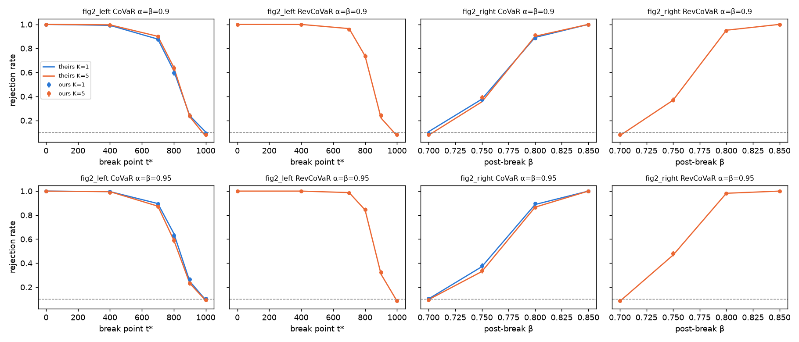
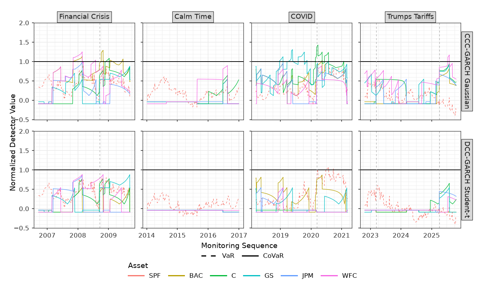

# Replication of Dimitriadis & Hoga (2026)

Scope: VaR, CoVaR and reverse CoVaR monitoring. The full notes (every number, deviation and check) are in `REPLICATION_NOTES.md` on `main`.

## 1. What we replicated, and how
We ported their method to Python: the UC and Gini detectors, Algorithm 1 critical values, the DCC-GARCH-t DGP and monitoring. R is used only to fit the multivariate GARCH models in the application. We used their stored thresholds, DGP settings and data.

| item | value |
|---|---|
| reference code | [TimoDimi/replication_CoVaR_Monitoring](https://github.com/TimoDimi/replication_CoVaR_Monitoring) @ `f025ef2` |
| RNG | NumPy PCG64, seed 2026 (they use R's RNG), so results agree in distribution only |
| exact checks | detectors and threshold selection vs their unchanged R functions: max diff 6e-15 |

## 2. Critical values (n = 1000, m = 250, ι = 0.1, B = 5000)
| α=β | K | c_VaR ours | c_VaR theirs | c_SysRisk ours | c_SysRisk theirs |
|---|---|---|---|---|---|
| 0.95 | 1 | 2.386 | 2.350 | 4.856 | 4.819 |
| 0.95 | 5 | 2.747 | 2.710 | 5.738 | 5.637 |

All 48 thresholds (3 levels × 4 K × CoVaR/reverse × 2) are within 3σ Monte Carlo error (max |z| 2.2). The selection step matches their R code exactly on the same input.

## 3. Size (Tables 1–2): Joint false-alarm rate, %, M = 5000
| α=β | K | Table 1 CoVaR ours | theirs | Table 2 reverse ours | theirs |
|---|---|---|---|---|---|
| 0.90 | 1 | 9.90 | 10.00 | – | – |
| 0.90 | 2 | 9.38 | 10.28 | 9.50 | 9.32 |
| 0.90 | 5 | 7.60 | 7.58 | 7.70 | 6.96 |
| 0.90 | 10 | 8.14 | 8.36 | 8.04 | 7.70 |
| 0.95 | 1 | 9.96 | 9.62 | – | – |
| 0.95 | 2 | 8.72 | 9.26 | 9.28 | 9.64 |
| 0.95 | 5 | 8.76 | 8.24 | 8.62 | 8.12 |
| 0.95 | 10 | 6.30 | 6.38 | 7.04 | 6.70 |

All 14 cells are within ±1.1pp. The first-detector shares are all within 3 SD (44/44 CoVaR, 68/68 reverse).

## 4. Power (Figure 2), M = 2000, K ∈ {1, 5}

All 192/192 cells (Figure 2 both panels, Figure 3 shares, Joint delays) are within 3σ. The largest deviation is |z| = 3.00.

## 5. Real-data application (Figures 5–6), α=β = 0.95

Joint first alarm, CoVaR monitoring. "Ours" is the date actually monitored; "theirs" is their stored date label.

| spec | window | ours | theirs | first detector |
|---|---|---|---|---|
| CCC-Gaussian | FinCrisis | 2007-11-07 | 2007-11-07 | CoVaR_BAC = CoVaR_WFC (tie) |
| CCC-Gaussian | CalmTime | none | none | |
| CCC-Gaussian | COVID | 2018-12-21 | 2018-12-28 | CoVaR_GS (label shift, § 6) |
| CCC-Gaussian | TrumpTariff | 2025-07-15 | 2025-07-15 | CoVaR_WFC |
| DCC-t | FinCrisis | none | none | |
| DCC-t | CalmTime | none | none | |
| DCC-t | COVID | 2020-03-18 | 2020-03-18 | VaR_SPF |
| DCC-t | TrumpTariff | none | none | |

Our detector paths match their stored results to 6.7e-16 in all 16 cells (2 specs × 4 windows × 2 modes). The first alarms are identical.

## 6. What we found
- **FinCrisis (CCC-Gaussian):** BAC and WFC alarm together on 2007-11-07. WFC does not alarm alone in 2008.
- **COVID date labels:** windows before July 2019 are labelled 4 trading days late, because labels are taken before `na.omit` drops 4 SPF NA rows (2019-07-01..05). None of the crash-period alarms are affected.
- **Table 2 label typo:** `eval_sim_AnyDetection.R` filters on `"Reversed CoVaR"` instead of `"Reverse CoVaR"`, so the reverse row of the any-detection table is blank.
- **Code issues:** `simulations/DGP.R` and `R/PIT_tDist.R` are sourced but missing. In the ν quirk, `I_VaR` uses `nu[1]` while bank k uses `nu[k+1]`. Thresholds use the closest-to-ι `which.min` rule, so the size can be slightly above ι. All of these are replicated.
- **Conventions we replicate:** two-sided UC detector `|mean(I) − p|`; the Gini detector ignores the censored last duration; the stored label `CoVaR_Exposure` is recoded to reverse; Figure 4 pools all 6 EstWindow files.

## 7. Not replicated (scope)
- Power for K = 2 and 10
- Grid points t* ∈ {200, 600, 850, 950} and β_post ∈ {0.87, 0.89, 0.899}; Figure 3 at α=β = 0.95
- Figure 4 (estimation effect; needs GARCH re-estimation in every replication)
- CCC-t and DCC-Gaussian application fits

## 8. How to reproduce
| result | command |
|---|---|
| exact R cross-checks | `.venv/bin/pytest -q` |
| critical values | `experiments/01_moments_and_thresholds.py --B 5000`; seed study `01b`, reduced table `01c`, bootstrap check `01d` |
| Table 1 (also persists null sims) | `experiments/02_table1_size.py --M 5000` |
| Table 2 | `experiments/03_table2_size_reverse.py --M 5000` |
| Figures 2–3 | `experiments/04_fig2_power.py --M 2000 --jobs 3` |
| Figures 5–6 | `Rscript r/fit_forecasts_application.R`, then `experiments/05_application_fig5_fig6.py` |
| targets from their stored results | `experiments/08_targets_sims.py`, `09_targets_application.py`, `10_data_alignment.py` |
